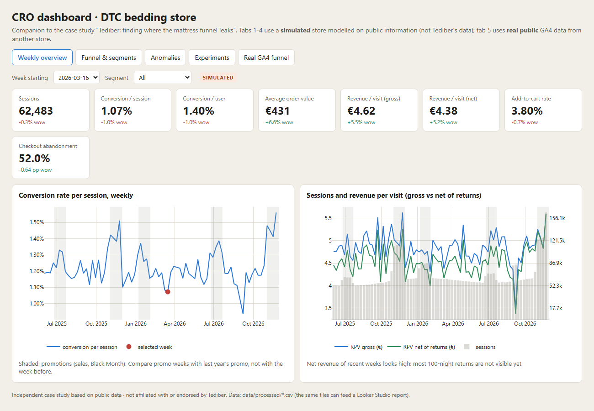

# Tediber: finding where the mattress funnel leaks, and testing the fix

Public company, market and page-speed data, real GA4 e-commerce journeys and a simulated, calibrated DTC bedding store
turned into a weekly CRO report, anomaly detection, a prioritised test backlog, power-planned A/B tests and reusable CRO
templates.

**[Report (PDF, 8 pages)](report/tediber_cro_case_study.pdf)** · **[Dashboard (HTML, offline)](dashboard/cro_dashboard.html)** ·
**[Excel toolkit](excel/tediber_cro_toolkit.xlsx)** · **[A/B test briefs and read-outs](docs/ab_tests/README.md)** ·
**[Notebook](notebooks/cro_analysis.ipynb)**

> Independent case study based on public data · not affiliated with or endorsed by Tediber.
> Every figure is tagged **PUBLIC DATA** (read from a public source, dated) or **SIMULATED** (a fictional DTC bedding
> store modelled on public information). Simulated numbers are never Tediber's.



## Key results
1. **The weekly monitoring found all 8 planted events, with 0 false incidents in 18 months** (SIMULATED): a Safari-iOS-only
   payment break and a mobile-only slowdown of mattress pages were caught in 2-5 days and linked to the right release;
   a traffic-mix drop of the topline and Black Month raised no incident; duplicate purchase events were caught by the
   daily reconciliation.
2. **In a real GA4 export, duplicate transaction ids inflate revenue by 7.4 %** and returning visitors convert 4.6x
   better than new ones (PUBLIC DATA, Google Merchandise Store - not Tediber): de-duplicate on `transaction_id` and report
   conversion per user next to conversion per session.
3. **A comparator that lifts conversion by 8 % can lose its gain to returns** (SIMULATED test D): 100-night returns rise
   from 7.6 % to 10.9 % and net revenue per visitor is +2.9 % [-3.4 %; +9.6 %] -> iterate, not ship.
4. **Tediber's public pages already have most good practices in place** (sticky add-to-cart bar, delivery date, bulky
   delivery fee on the product page, trial and returns under the button, comparator, quiz). Opportunities to test: one
   split-payment message (3x-24x vs 3x-12x), a delivery promise adapted on bulky-item pages, and a mobile performance
   budget once real-user data confirm the lab measures (PUBLIC DATA, 17 Nov 2026).

## What is inside
| Folder | Content |
|---|---|
| `sql/` | DuckDB SQL, commented (CTEs, window functions, GROUPING SETS): `01_weekly_kpis`, `02_funnel`, `03_anomalies` (robust baseline, promo calendar, rate / mix decomposition), `04_reconciliation`, `05_experiments` (SRM); `ga4/` the funnel and data-quality checks on the real GA4 export |
| `src/` | collectors (polite), simulation, statistics (`stats_tests.py`), weekly note + number checker, Excel, dashboard, notebook and PDF builders |
| `excel/` | 6 tabs, real formulas: Weekly report (pick a week), Funnel, Anomalies, CRO backlog (ICE / RICE), Test calculator (sample size, z test, CI, SRM), Test log |
| `docs/` | KPI dictionary, GA4 tracking plan, UX audit (drawn page schema, no screenshot), 4 test briefs + 4 read-outs, weekly and quarterly templates, benchmark, AI guardrails |
| `weekly_notes/` | weekly notes drafted from the data, every number checked |
| `data/processed/` | every aggregate behind the report (also usable as Looker Studio sources) |
| `tests/` | 21 tests: number-checker traps, statistics vs textbook values, published outputs |

## Methods
- **Public data**: French company register (open API), Tediber's public pages and sitemap (robots.txt respected, one
  request every 10 s, no cart / checkout / account / search), Lighthouse lab runs (6 pages x 2 devices x 3), Eurostat,
  FEVAD and Baymard (as stated), and the GA4 obfuscated sample of the Google Merchandise Store (streamed with DuckDB from a
  Hugging Face mirror, MIT). Details and dates: [`data/SOURCES.md`](data/SOURCES.md).
- **Simulation**: 18 months day by day (~5.4 M sessions aggregated by day x device x browser x channel x visitor type x
  entry category), calibrated on public orders of magnitude, with 8 hidden events; the answer key was used once to score
  the detection and is not published. Assumptions: [`data/ASSUMPTIONS.md`](data/ASSUMPTIONS.md).
- **Monitoring**: 7-day rates per slice and funnel step, expected value = same-weekday median over 8 weeks (promotions
  excluded; inside a promotion, last year's promotion), robust z, then triage: traffic mix, data reconciliation, release log.
- **Tests**: sample size and duration fixed before launch, SRM check first, z test and 95 % intervals, bootstrap for
  revenue per visitor, 100-night return rate as a guardrail, decision rule written in advance (ship / iterate / drop),
  peeking simulation.
- **Weekly note**: drafted from a fact sheet (sentence template by default; optional LLM draft) and **rejected if any
  number does not match the data** (`src/check_numbers.py`; see [`docs/AI_REPORTING_GUARDRAILS.md`](docs/AI_REPORTING_GUARDRAILS.md)).
- AI-assisted workflow: I used Claude, mainly to write scripts faster. I drove the project: I defined the questions, chose and validated the data sources, made the analytical decisions and checked every result.

## How to rerun (no key needed)
```bash
python -m venv .venv && .venv/Scripts/activate      # Windows; on macOS/Linux: source .venv/bin/activate
pip install -r requirements.txt
python src/extract_ga4.py          # real GA4 events (~1.8 GB streamed, ~60 MB kept locally, not committed)
python src/simulate.py             # simulated store -> data/sim/
python src/run_sql.py              # all SQL -> data/processed/
python src/analyse.py              # test read-outs, power plan, peeking, impact, detection scorecard
python src/build_excel.py --verify # workbook + recalculation check (LibreOffice)
python src/weekly_summary.py       # verified weekly note -> weekly_notes/
pytest
python src/build_notebook.py       # executes notebooks/cro_analysis.ipynb
python src/build_dashboard.py
python src/build_pdf.py            # needs Edge or Chrome
```
Public collectors (already run on 17 Nov 2026, outputs in `data/processed/`): `collect_registry.py`, `collect_public.py`,
`collect_market.py`, `run_lighthouse.py` (Node.js + Lighthouse), `ux_audit.py`, `build_test_docs.py`.

## Limits
The simulated store is not Tediber: its levels illustrate the method, not the company's performance. Lighthouse gives lab
data on one simulated device (real-user Core Web Vitals not collected). The audit covers public pages only. The GA4 sample
is another store (2020-2021, obfuscated). Returns of recent weeks are not mature; impacts are ranges.

## Licences
Code: MIT. Data: company register (Etalab open licence), Eurostat (re-use with attribution), GA4 sample (Google public
dataset; mirror under MIT); FEVAD and Baymard figures quoted briefly with their source. No personal data is published.
