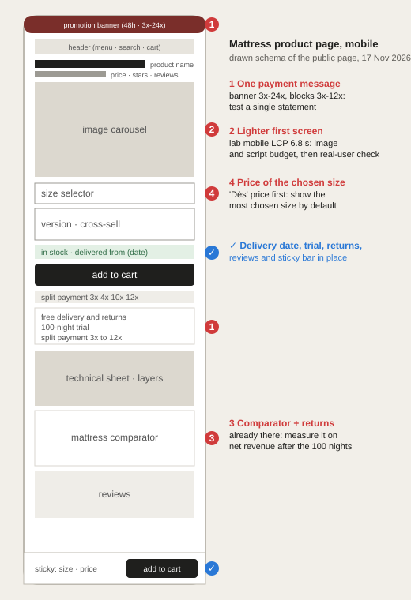

# UX audit - Tediber public pages (17 Nov 2026)

Heuristic review of the public journey **homepage -> category -> product page** on mobile (412 px) and desktop.
Cart, checkout, account and search were **not** visited (robots.txt). Scores: 0 absent, 1 partly, 2 present and clear.
Findings are written as **opportunities to test**; most good practices are already in place.

**Total: mobile 42/52, desktop 46/52.**

| Area | Criterion | Page | Mobile | Desktop | Observation | Hypothesis to test |
|---|---|---|---|---|---|---|
| Offer clarity | Value proposition visible without scrolling | Home | 2 | 2 | Promotion hero, trust line and range entry points at the top | keep |
| Offer clarity | Ranges and categories reachable in one tap | Home | 2 | 2 | Icon row (Black Month, mattresses, packs, bed bases, beds) under the header | keep |
| Offer clarity | Current promotion explained with its conditions | Home | 1 | 1 | 'Jusqu'à -40%' with an asterisk; conditions in the terms of sale | A one-line condition next to the banner reduces surprise in the cart |
| Reassurance | Trial period stated near the decision | Product | 2 | 2 | 100 nights listed under the add-to-cart button | keep |
| Reassurance | Free returns stated near the decision | Product | 2 | 2 | 'Livraison et retour gratuit' under the button | keep |
| Reassurance | Made-in / certifications visible | Product | 2 | 2 | 'Fabriqué en France' and OEKO-TEX badges on product images | keep |
| Social proof | Rating and review count next to the price | Product | 2 | 2 | Stars and review count under the product name | keep |
| Social proof | Reviews readable on the page | Product | 2 | 2 | Review widget lower on the page | keep |
| Price & payment | Price per size clear before choosing | Product | 1 | 1 | 'Dès' price shown first; price updates with the size | Showing the price of the most chosen size first may reduce the 'Dès' gap |
| Price & payment | Strike-through price and discount consistent | Category / product | 2 | 2 | Old price, new price and % badge shown together | keep |
| Price & payment | Split-payment offer stated the same way everywhere | Banner / home / product | 1 | 1 | Banner says 3x to 24x; engagement blocks and product page say 3x to 12x | One message everywhere (B06) |
| Delivery | Delivery date shown on the product page | Product (mattress) | 2 | 2 | 'Livré dès le ...' estimate under the options | keep |
| Delivery | Delivery fee and options for bulky items shown before the cart | Product (bed base) | 2 | 2 | Essential delivery free; room delivery 25 EUR, free from 1,000 EUR | keep (test C shows how to measure it) |
| Delivery | Delivery promise consistent by product type | Banner / bulky pages | 1 | 1 | 'Livraison en 48h' banner on every page; bulky items 8-10 days per the delivery page | Adapt the banner on bulky-item pages (B07) |
| Choice support | Comparison of mattress models | Category / product | 2 | 2 | Comparison table on the category page and comparator on the product page | keep; judge it on net revenue after returns (test D) |
| Choice support | Guided choice (quiz) | Category | 2 | 2 | 'Quel matelas choisir ?' quiz, under 2 minutes | Carry the quiz result to the product page (B10) |
| Choice support | Key specs on product tiles (height, firmness, layers) | Category | 2 | 2 | Three spec lines on every mattress tile | keep |
| Choice support | Filters and sort on category pages | Category | 2 | 2 | 'Filtrer' and 'Trier par' above the grid | keep |
| Mobile ergonomics | Add-to-cart reachable while scrolling | Product | 2 | 2 | Sticky bar with price and button (mobile and desktop) | keep (test A shows how to measure it) |
| Mobile ergonomics | Tap targets and text size on mobile | All | 2 | 2 | Large buttons; small grey legal text only | keep |
| Mobile ergonomics | Consent panel leaves the page usable | All | 1 | 1 | In our capture the panel covers most of the mobile screen | Compact layout, to test with the legal team (B14); confirm on a real phone |
| Mobile ergonomics | Help reachable (chat, phone) | All | 2 | 2 | Chat button bottom right | keep |
| Performance | Largest content shown fast on mobile (lab) | All | 0 | 2 | Lab LCP 6.8 s or more on mobile, below 2 s on desktop | Image and script budget on mobile; confirm with real-user data first (B05) |
| Performance | Main thread free on mobile (lab blocking time) | All | 0 | 1 | Lab blocking time above 1 s on mobile pages | Defer non-essential third-party scripts (B05) |
| Performance | Layout stable while loading | All | 2 | 2 | Lab CLS close to 0 on all pages | keep |
| Stores | Physical stores visible for people who want to try | Product (mattress) | 1 | 2 | 4 stores in the footer and store locator; not seen near the mattress decision on mobile | 'Try it in store' block (B11) |

## Opportunities to test, in Tediber's own pages
1. **One split-payment message** (3x-24x in the banner, 3x-12x in the blocks and on the product page).
2. **Mobile performance budget** - lab mobile LCP and blocking time are high on every page measured; confirm with
   real-user Core Web Vitals (CrUX) before investing, then test lighter images and deferred third-party scripts.
3. **Delivery promise by product type** - the '48h' banner also shows on bulky-item pages (8-10 days).
4. **Measure the comparator and the quiz on net revenue after returns**, not on conversion only (simulated test D).
5. **Carry the quiz result to the product page**; **'try it in store'** near the mattress decision.

Already in place (to keep, and to measure the same way): sticky add-to-cart bar, delivery date, delivery options and
fee for bulky items, trial and free returns under the button, reviews next to the price, filters, specs on tiles.

*Method: own review of the public pages; no screenshot of the site is published (the schema above is drawn).*
